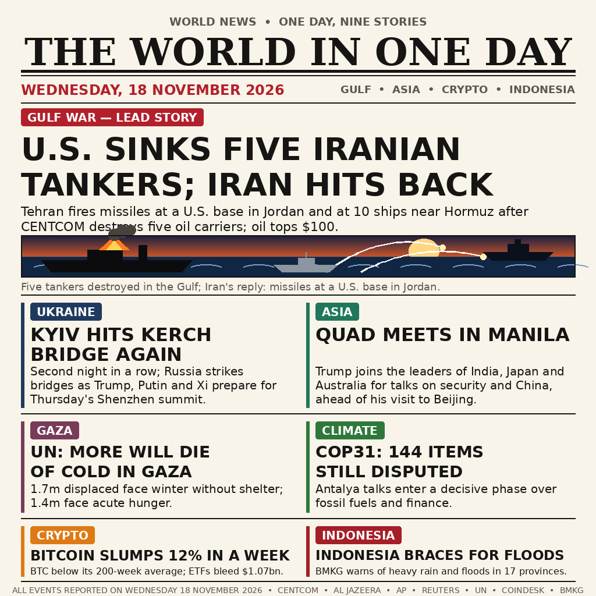

# The World in One Day — 18 November 2026

[](https://make.fun/bounty/news-image-20261118?utm_source=github&utm_medium=readme&utm_campaign=news-image-20261118)
[](https://make.fun/bounty/news-image-20261118/leaderboard?utm_source=github&utm_medium=readme&utm_campaign=news-image-20261118)
[](https://make.fun/bounty/news-image-20261118?utm_source=github&utm_medium=readme&utm_campaign=news-image-20261118)

A newspaper front page summing up the world's news of **Wednesday 18 November 2026** — one image, nine stories. Entry for the make.fun **news-image-20261118** bounty ($250, 50 paid places).



## The day's stories

1. **GULF WAR (lead)** — U.S. sinks five Iranian tankers; Iran hits back. CENTCOM destroyed the Kaviz, Charminar, Horizon 1 and Riesco in the Gulf of Oman and the Derya near Kharg Island after the IRGC twice targeted a U.S. warship; Iran fired missiles at the U.S. base at Al-Azraq in Jordan and at 10 ships near the Strait of Hormuz. Oil topped $100 a barrel.
2. **UKRAINE** — Kyiv hits the Kerch Bridge a second night in a row; Russia strikes bridges as Trump, Putin and Xi prepare for Thursday's trilateral summit in Shenzhen.
3. **ASIA** — Quad leaders meet in Manila: Trump joins the leaders of India, Japan and Australia for talks on security and China, ahead of his visit to Beijing.
4. **GAZA** — UN warns more will die of cold: 1.7 million displaced face winter without shelter; 1.4 million face acute hunger.
5. **CLIMATE** — COP31 in Antalya enters a decisive phase with 144 items still disputed.
6. **CRYPTO** — Bitcoin slumps 12% in a week, falling below its 200-week average near $65,000; U.S. spot Bitcoin ETFs bled $1.07bn in a week and the Fear & Greed Index sits at 12 — extreme fear.
7. **INDONESIA** — BMKG warns of heavy rain, lightning and strong winds — and floods — in 17 provinces from 17 to 23 November 2026.

Every fact was checked against reporting of 18 November 2026 (CENTCOM, Al Jazeera, AP, Reuters, UN, CoinDesk, BMKG).

## How it is made

The image was composed offline with Python/PIL and DejaVu fonts (`draw_poster.py`, kept out of this repo as build tooling) and ships here as `entry.png` (1024×1024, 136 KB). The entrypoint `main.ts` (Node 22, standard library only) copies it to `/output/entry.png` and verifies it first: PNG magic bytes, every chunk's CRC, IHDR dimensions, the 1 MiB / 1024×1024 caps, and a byte-identical read-back. No network, no clock, no randomness — both grader runs write the same bytes.

## Run it

```sh
mkdir -p out && MAKEFUN_OUTPUT_DIR=out node main.ts
```

## License

MIT — see [LICENSE](LICENSE).
